# SZABIST Smart Digital Library

**A full-stack library management system for SZABIST with separate Student and Librarian portals: search the catalogue, reserve books, join a waitlist, issue and return books, renew loans, and track fines automatically.**


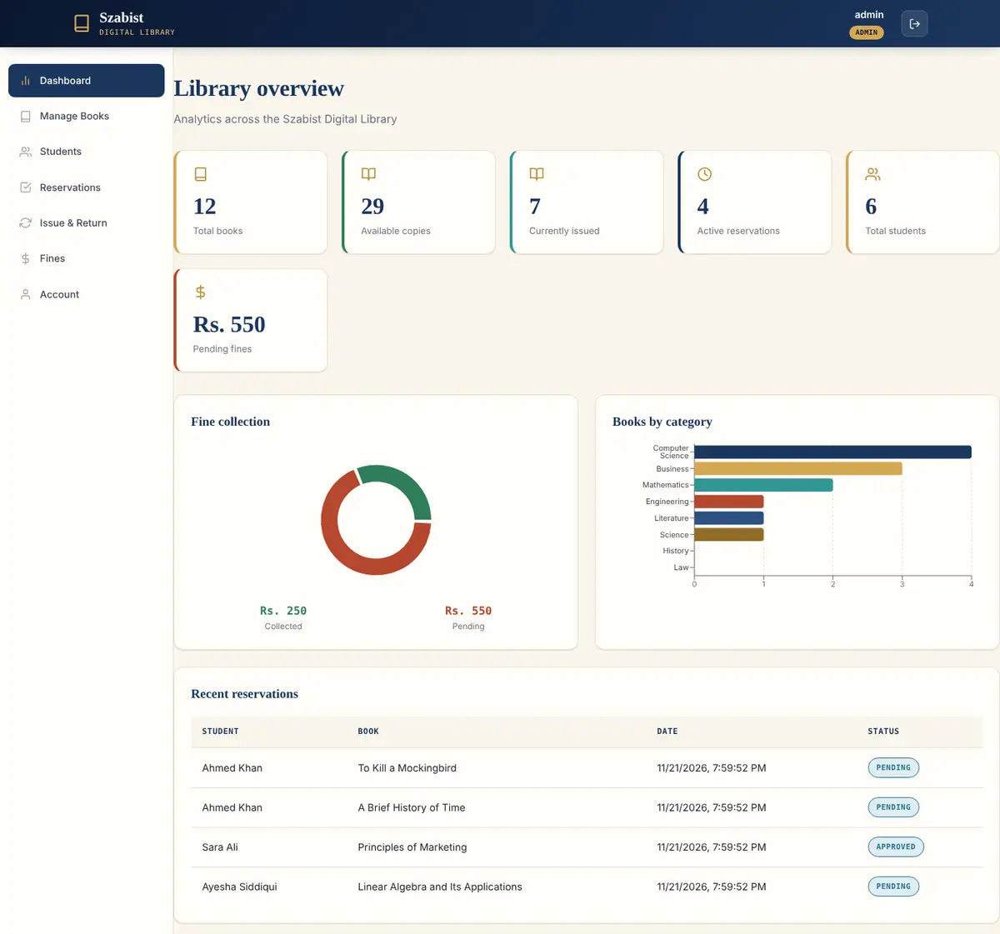

## Overview

University libraries that run on registers and spreadsheets make students walk to the counter just to find out if a book is in. Holds get lost, nobody knows who is next in line for a popular title, and late fines are worked out by hand.

**SZABIST Smart Digital Library** moves that work online:

- **Students** search the catalogue, see the exact rack and shelf, reserve a copy (24-hour hold), join a waitlist when all copies are out, renew their own loans, and see their fines and notifications.
- **Librarians** manage books and students, approve reservations, issue and return books, and collect fines, all from one dashboard with charts and CSV export.

It is a React single-page app talking to a Node.js / Express REST API. Data is stored in a local SQLite file (through `sql.js`), so there is no database server to install.

## Screenshots

### Librarian (admin) portal

| Book management | Add a book |
|---|---|
| 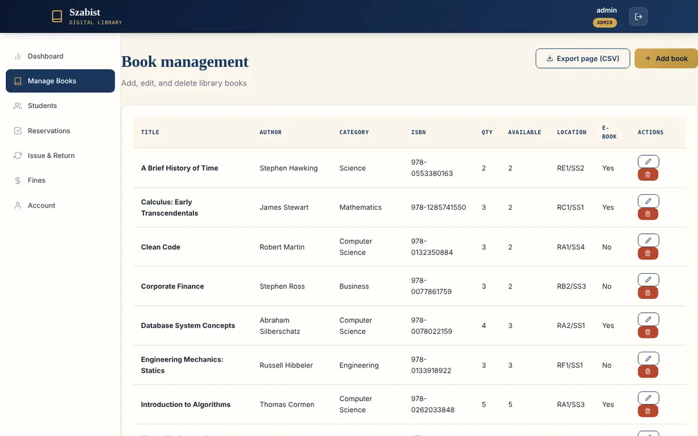 | 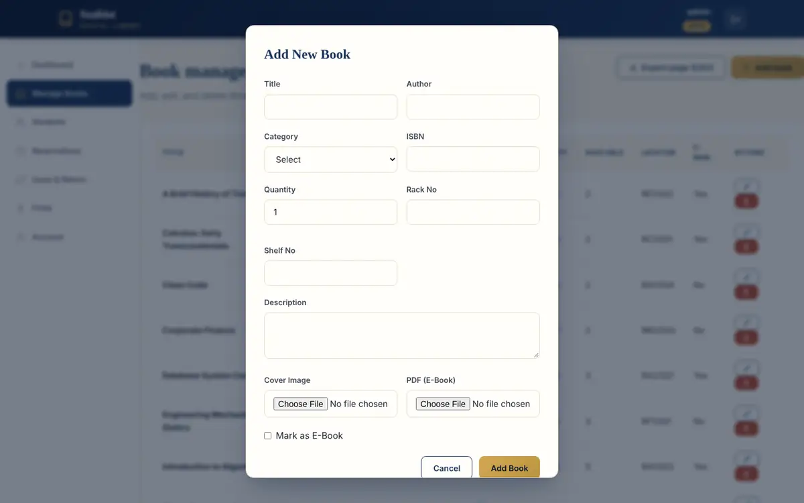 |

| Issue & return | Reservations |
|---|---|
| 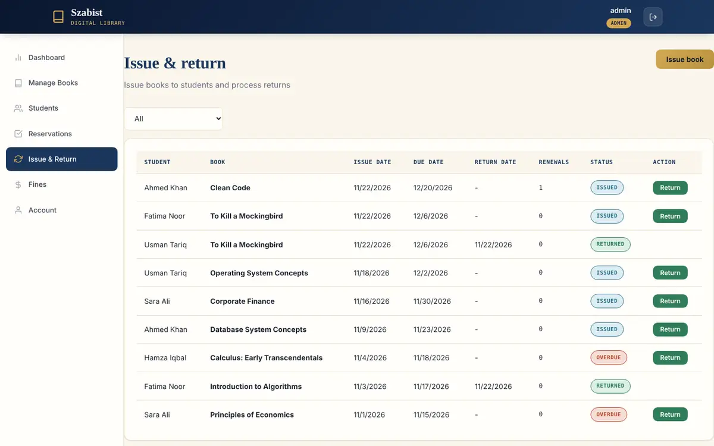 | 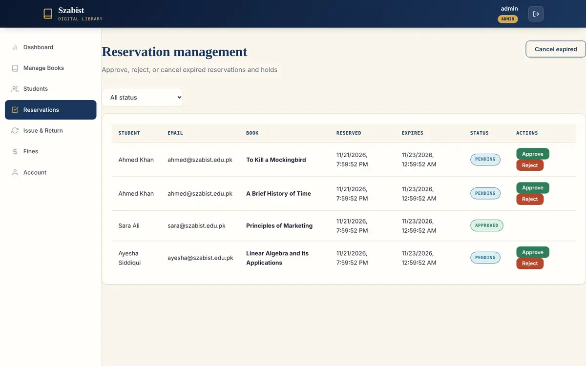 |

| Students | Fines |
|---|---|
| 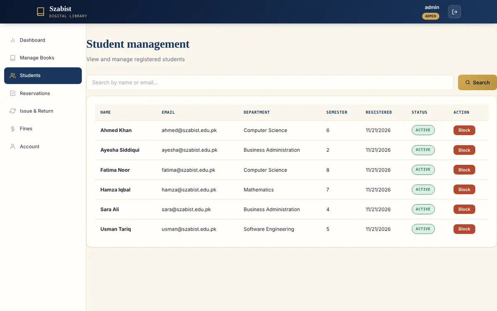 | 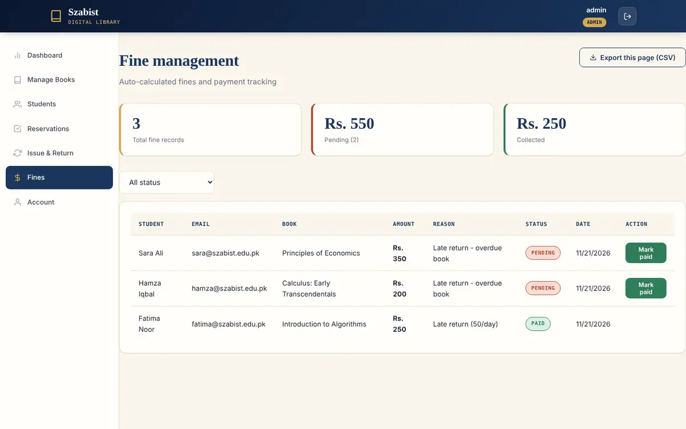 |

### Student portal

| Student dashboard | Search the catalogue |
|---|---|
| 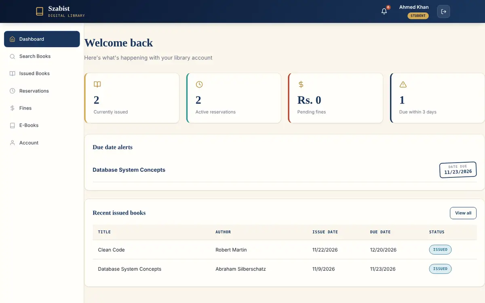 | 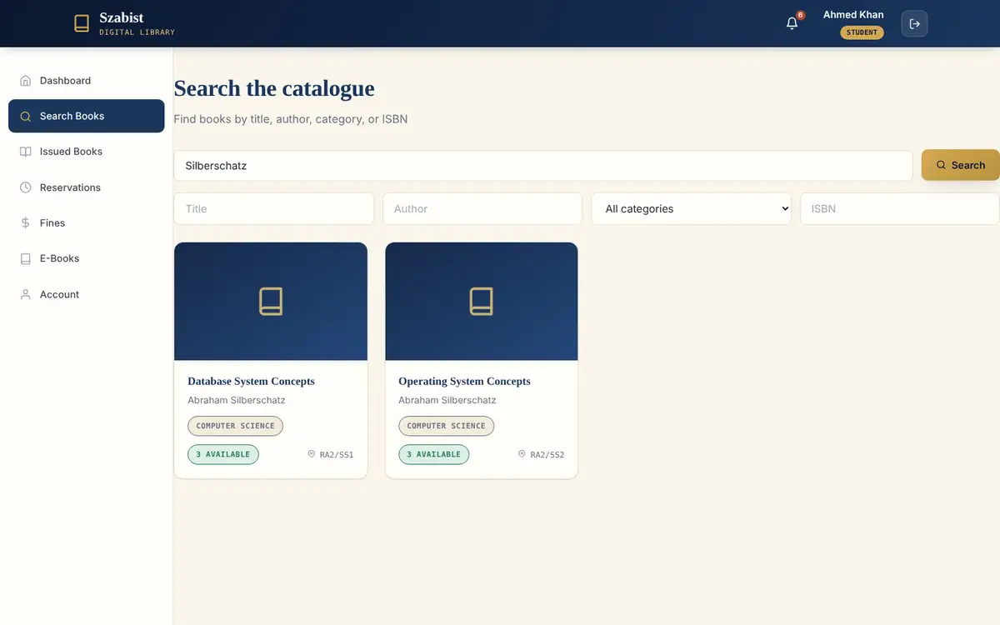 |

| Book details | Issued books |
|---|---|
| 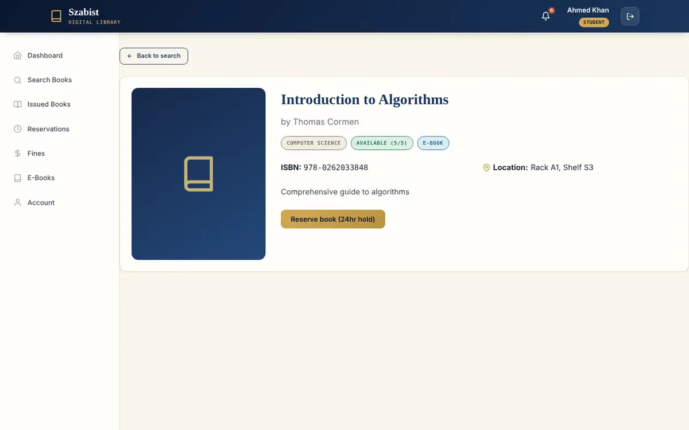 | 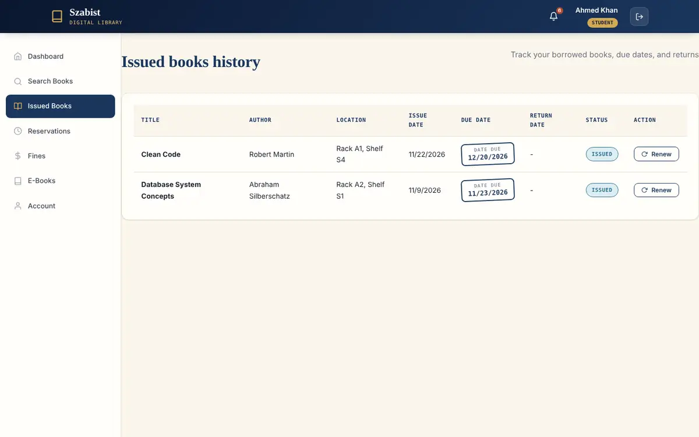 |

| My reservations | Notifications |
|---|---|
| 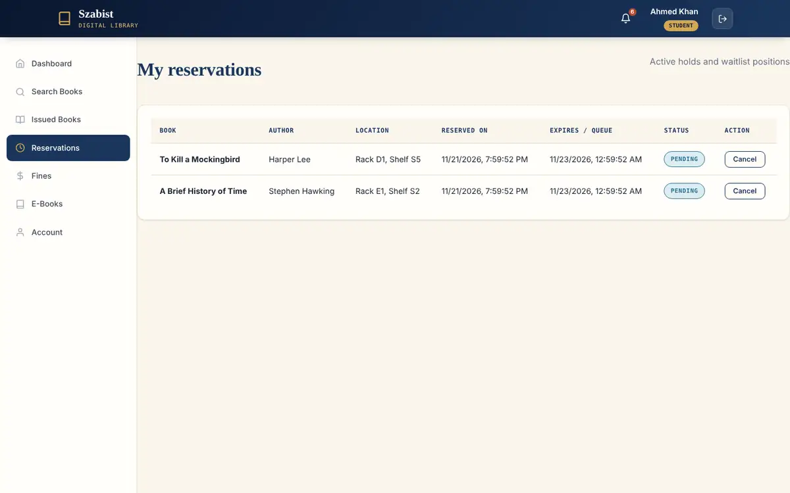 | 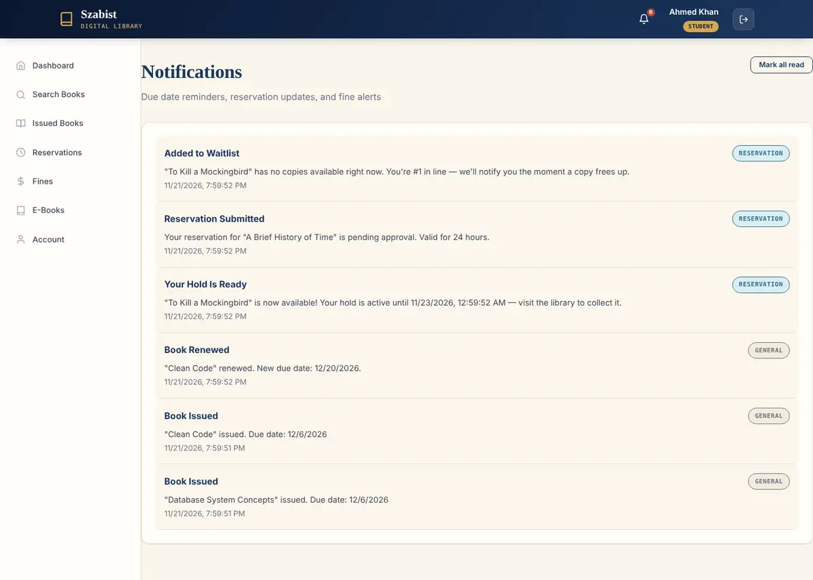 |

<details>
<summary><b>Login page</b></summary>

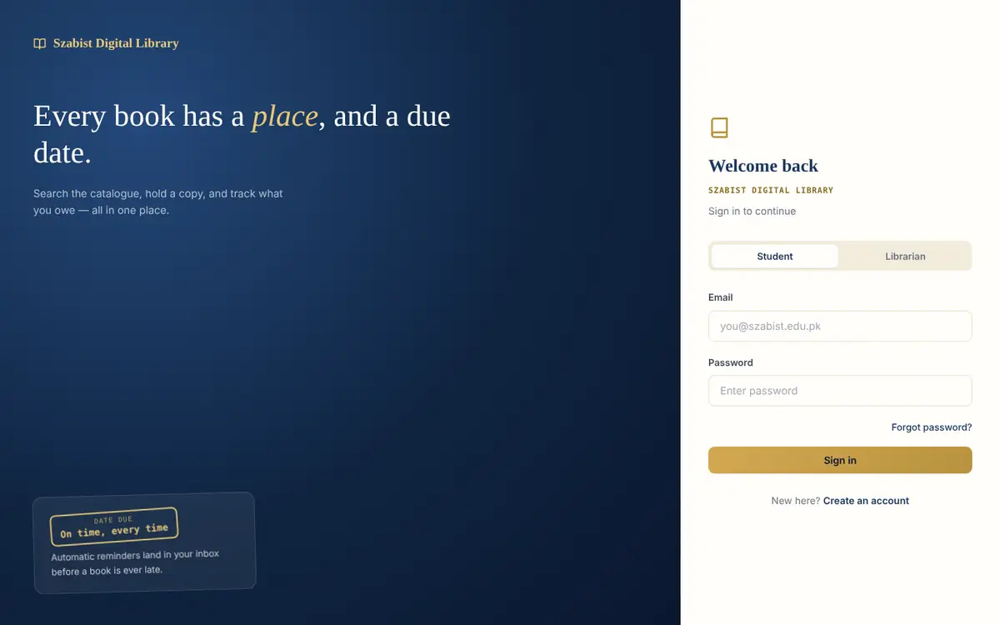

</details>

> Screenshots show the app running locally with sample data. The books are entries from the project's seed script; the students and all activity are fictional.

## Problem and solution

| Problem | How the system solves it |
|---|---|
| Students can't tell if a book is in without visiting the library | Online catalogue search with live available-copy counts and rack/shelf location |
| Popular books have no fair queue | Reservations with a 24-hour hold, and a FIFO waitlist that promotes the next student automatically when a copy is returned |
| Loans and due dates are tracked on paper | Issue & return screen; due dates set automatically (14 days by default); self-service renewals |
| Late fines are calculated by hand | Fines are calculated per overdue day (Rs. 50 by default) by a daily job and on return |
| Students miss due dates | Due-date alerts on the dashboard, in-app notifications, and optional email reminders |
| No overview for library staff | Admin dashboard with totals, fine collection and books-by-category charts, plus CSV export |

## Features

### Student

| Feature | Details |
|---|---|
| **Account** | Register, log in, forgot / reset password (emailed link, valid 1 hour), edit profile, change password |
| **Dashboard** | Currently issued books, active reservations, pending fines, books due within 3 days |
| **Catalogue search** | Quick search plus filters for title, author, category and ISBN; paginated |
| **Book details** | ISBN, description, rack and shelf location, available copies, e-book badge |
| **Reservations** | 24-hour hold; duplicate reservations prevented; cancel your own pending or waitlisted reservation |
| **Waitlist (hold queue)** | When no copies are available you join the queue; when a copy is returned the first student in line gets an active hold plus an in-app (and email) notification |
| **Renewals** | Renew your own loan up to 2 times; blocked if the book is overdue or another student is waiting for it |
| **Issued books** | Full borrowing history with due dates and return dates |
| **Fines** | Your pending and paid fines |
| **E-books** | Download PDFs for books the library has uploaded as e-books |
| **Notifications** | Due-date reminders, reservation updates, fine alerts; mark as read / mark all read |

### Librarian (admin)

| Feature | Details |
|---|---|
| **Dashboard** | Total books, available copies, issued books, active reservations, students and pending fines; fine collection and books-by-category charts; recent reservations |
| **Book management** | Add, edit and delete books with cover image and PDF upload; paginated; CSV export |
| **Student management** | Search students; block / unblock accounts |
| **Reservations** | Approve or reject reservations; cancel expired holds |
| **Issue & return** | Issue a book to a student; return it (available copies update automatically and the waitlist is promoted); filter by issued, overdue, returned |
| **Fines** | Filter by status, mark fines as paid, totals for pending and collected; CSV export |

### Background jobs

Scheduled with `node-cron` while the server is running:

- **Daily at 08:00**: mark overdue loans, create or update their fines, expire old reservations, and send due-date reminders for books due within 2 days.
- **Every hour**: expire reservations whose hold time has passed.

## Architecture

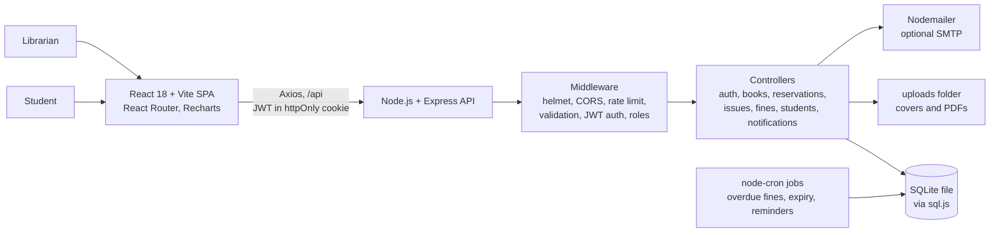

**Reservation and loan workflow**

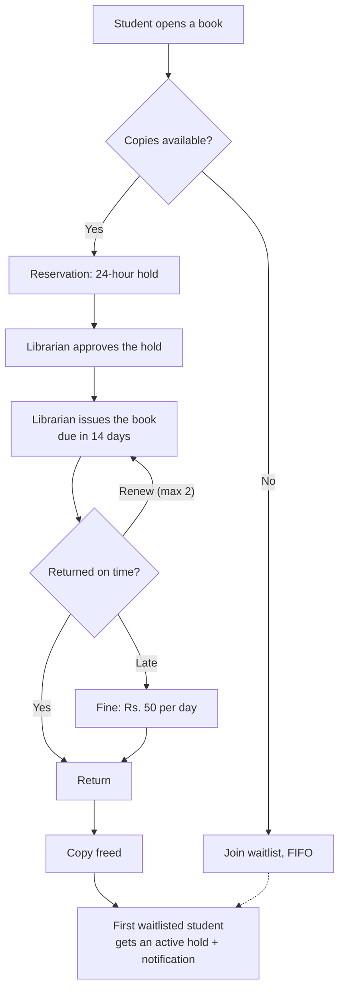

1. The React app sends requests to `/api`; the Vite dev server proxies them to the Express API on port 5000.
2. Login sets a JWT in an **httpOnly cookie**, so the token is never readable by JavaScript.
3. Middleware adds security headers (helmet), CORS, rate limiting, input validation and role checks (student or admin).
4. Controllers read and write a SQLite database file through `sql.js`. The schema is created automatically on first start.
5. Uploaded cover images and e-book PDFs are stored in `backend/uploads/` (PDFs only, images only, 20 MB limit).

## Tech stack


| Layer | Technology |
|---|---|
| Frontend | React 18, Vite 5, React Router 6, Axios, Recharts, React Icons, React Hot Toast, React Loading Skeleton, CSS |
| Backend | Node.js, Express 4, jsonwebtoken, bcryptjs, cookie-parser, helmet, cors, express-rate-limit, express-validator, multer, node-cron, nodemailer, dotenv |
| Database | SQLite through `sql.js` (single local file, created automatically) |
| Testing | Jest, Supertest (integration tests) |
| Dev tools | nodemon |

## Project structure

```text
Szabist-library-management-system/
├── backend/
│   ├── server.js               # Starts the API and the cron jobs
│   ├── app.js                  # Express app: middleware and route mounting
│   ├── config/db.js            # SQLite (sql.js) connection and query helper
│   ├── controllers/            # Auth, books, reservations, issues, fines, students, notifications
│   ├── routes/                 # API route definitions
│   ├── middleware/             # JWT auth, roles, rate limiting, validation, file uploads
│   ├── utils/                  # Fines, waitlist, notifications, email
│   ├── cron/jobs.js            # Scheduled overdue / expiry / reminder jobs
│   ├── scripts/seed.js         # Creates the default admin, students and books
│   ├── tests/                  # Jest + Supertest integration tests
│   └── .env.example
├── frontend/
│   ├── src/
│   │   ├── pages/admin/        # Dashboard, ManageBooks, ManageStudents, ManageReservations, IssueReturn, ManageFines
│   │   ├── pages/student/      # Dashboard, BookSearch, BookDetails, IssuedBooks, Reservations, Fines, Ebooks, Notifications
│   │   ├── pages/auth/         # Login, Register, ForgotPassword, ResetPassword
│   │   ├── components/         # Layout, Navbar, Sidebar, AuthHero
│   │   ├── context/            # Auth context
│   │   ├── services/api.js     # Axios client (cookies, 401 handling)
│   │   └── utils/csv.js        # CSV export helper
│   └── vite.config.js          # Dev server and /api proxy
├── database/
│   ├── schema.sqlite.sql       # SQLite schema used by the app
│   ├── schema.sql              # MySQL version of the schema
│   └── migrations/
└── docs/screenshots/           # README images
```

## Getting started

### Prerequisites

- [Node.js](https://nodejs.org/) 18 or higher and npm

You do **not** need to install MySQL or any database server. The SQLite file is created automatically.

### 1. Clone

```bash
git clone https://github.com/Bhavish295/Szabist-library-management-system.git
cd Szabist-library-management-system
```

### 2. Backend

```bash
cd backend
cp .env.example .env      # Windows: copy .env.example .env
npm install
npm run seed              # creates the admin, two students and sample books
npm run dev               # API on http://127.0.0.1:5000
```

### 3. Frontend

In a second terminal:

```bash
cd frontend
npm install
npm run dev               # app on http://localhost:5173
```

Open **http://localhost:5173**.

### Demo accounts (created by `npm run seed`)

> ⚠️ **Demo only.** These accounts and passwords are for local testing. Change or remove them before using the system for real or deploying it anywhere.

| Role | Login | Password |
|---|---|---|
| Librarian (choose the **Librarian** tab) | `admin` | `admin123` |
| Student | `ahmed@szabist.edu.pk` | `student123` |

### Configuration (`backend/.env`)

| Variable | Default | Description |
|---|---|---|
| `PORT` | `5000` | API port (the Vite proxy expects 5000) |
| `DB_FILE` | `data/library.sqlite` | SQLite database file |
| `JWT_SECRET` | _(required)_ | Secret for signing login tokens. The server refuses to start without it. Use a long random value |
| `JWT_EXPIRES_IN` | `7d` | Login token lifetime |
| `SMTP_HOST`, `SMTP_PORT`, `SMTP_USER`, `SMTP_PASS`, `EMAIL_FROM` | _(optional)_ | Email settings for reminders and password reset. In-app notifications work without them |
| `FRONTEND_URL` | `http://localhost:5173` | Allowed CORS origin and base URL for reset links |
| `FINE_PER_DAY` | `50` | Fine per overdue day (Rs.) |
| `RESERVATION_HOLD_HOURS` | `24` | How long a hold stays active |
| `BOOK_ISSUE_DAYS` | `14` | Loan period |
| `MAX_RENEWALS` | `2` | Renewals allowed per loan (not in `.env.example`; add it to override) |

### Scripts

| Command | Location | Description |
|---|---|---|
| `npm run dev` | backend | Start the API with nodemon |
| `npm start` | backend | Start the API |
| `npm run seed` | backend | Create default admin, students and books |
| `npm test` | backend | Run the integration tests |
| `npm run dev` | frontend | Start the Vite dev server |
| `npm run build` | frontend | Production build |

## Testing

The backend has an integration test suite (Jest + Supertest) covering auth, book search, and the full reservation / waitlist and issue / renewal flows.

```bash
cd backend
npm test
```

Tests use `backend/data/library.test.sqlite` (configured in `backend/.env.test` and rebuilt from `database/schema.sqlite.sql` on every run), so they never touch your development database.

## API endpoints

Most routes need a logged-in session (the httpOnly cookie, or an `Authorization: Bearer <token>` header for API clients).

| Method | Endpoint | Access | Description |
|---|---|---|---|
| `GET` | `/api/health` | Public | Health check |
| `POST` | `/api/auth/register` | Public | Student registration |
| `POST` | `/api/auth/login` | Public | Login (student, or admin with `role: "admin"`) |
| `POST` | `/api/auth/logout` | Public | Clear the session cookie |
| `POST` | `/api/auth/forgot-password` | Public | Email a password reset link |
| `POST` | `/api/auth/reset-password` | Public | Set a new password with the reset token |
| `GET` / `PUT` | `/api/auth/profile` | Logged in | View / update own profile |
| `PUT` | `/api/auth/change-password` | Logged in | Change own password |
| `GET` | `/api/books/search` | Public | Search books (paginated) |
| `GET` | `/api/books/categories` | Public | List categories |
| `GET` | `/api/books/:id` | Public | Book details |
| `GET` | `/api/books/:id/download` | Student | Download e-book PDF |
| `POST` / `PUT` / `DELETE` | `/api/books`, `/api/books/:id` | Admin | Add / edit / delete books (with uploads) |
| `POST` | `/api/reservations` | Student | Reserve a book, or join the waitlist if none are available |
| `GET` | `/api/reservations/my` | Student | Own reservations |
| `PUT` | `/api/reservations/:id/cancel` | Student | Cancel own pending / waitlisted reservation |
| `GET` | `/api/reservations` | Admin | All reservations |
| `PUT` | `/api/reservations/:id/approve`, `/reject` | Admin | Approve / reject |
| `POST` | `/api/reservations/cancel-expired` | Admin | Cancel expired holds |
| `GET` | `/api/issues/my` | Student | Own issued books |
| `POST` | `/api/issues/:id/renew` | Student | Renew own loan |
| `GET` | `/api/issues` | Admin | All issue records |
| `POST` | `/api/issues/issue` | Admin | Issue a book |
| `POST` | `/api/issues/return` | Admin | Return a book (promotes the next waitlisted student) |
| `GET` | `/api/fines/my` | Student | Own fines |
| `GET` | `/api/fines`, `/api/fines/stats` | Admin | All fines / totals |
| `PUT` | `/api/fines/:id/pay` | Admin | Mark a fine as paid |
| `GET` | `/api/students/dashboard` | Student | Student dashboard data |
| `GET` | `/api/students` | Admin | List students |
| `PUT` | `/api/students/:id/toggle-block` | Admin | Block / unblock a student |
| `GET` | `/api/dashboard` | Admin | Admin analytics |
| `GET` | `/api/notifications`, `/unread-count` | Student | Notifications |
| `PUT` | `/api/notifications/:id/read`, `/read-all` | Student | Mark as read |

## Security

- Passwords hashed with bcrypt; JWT stored in an **httpOnly cookie** instead of `localStorage`.
- `helmet` security headers, CORS limited to `FRONTEND_URL`, and rate limiting (stricter on login, registration and password reset).
- All input validated with `express-validator`; uploads limited by file type and size.
- Error responses never include stack traces.
- Never commit your `.env` file. Change `JWT_SECRET` and the default passwords before deploying.

## Known issues

These bugs are in the current code and are **not fixed yet**:

1. **Duplicate fine on return.** The daily overdue job creates a fine for each overdue loan. If the librarian then returns that book, the return step calculates and adds a second fine for the same loan instead of updating the existing one. The student ends up with two fine records for one late book.
2. **Fine can be one day too high in some hours.** Overdue days are counted using two different clocks: SQLite's `date('now')` (UTC) and the server's local date. In time zones ahead of UTC (for example Pakistan, UTC+5), between midnight and 5 AM local time the count is off by one, so the fine is one day (Rs. 50 by default) higher. This also makes the test `admin issues a book; a late return produces the correct fine` fail when run during those hours.

## Color theme

- Navy Blue (`#1a365d`): primary brand
- Gold (`#d4a853`): SZABIST accent
- Teal (`#319795`): secondary accent

## Future improvements

These are **not implemented yet**:

- Barcode / QR scanning at the issue desk
- Online fine payment
- Multiple librarian accounts with different permissions
- A hosted demo

## Author

**Bhavish Kumar**: Full Stack Developer · AI Automation Engineer · Backend Developer

[GitHub](https://github.com/Bhavish295) · [LinkedIn](https://www.linkedin.com/in/bhavish-kumar-ab40a9303) · [Portfolio](https://bhavish-kumar-portfolio.netlify.app/)
